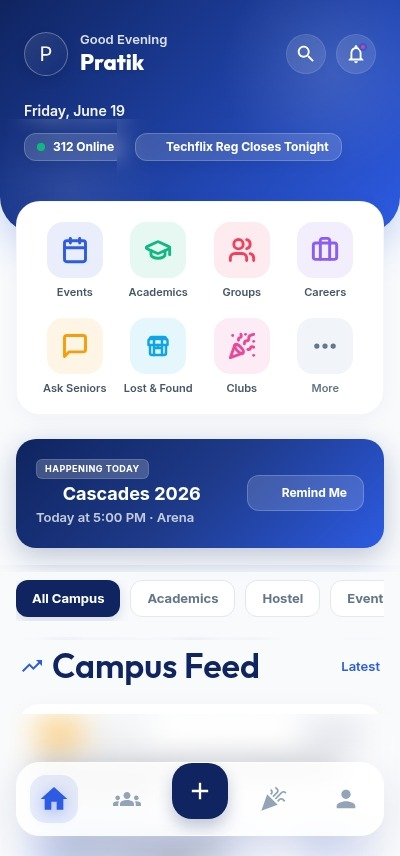
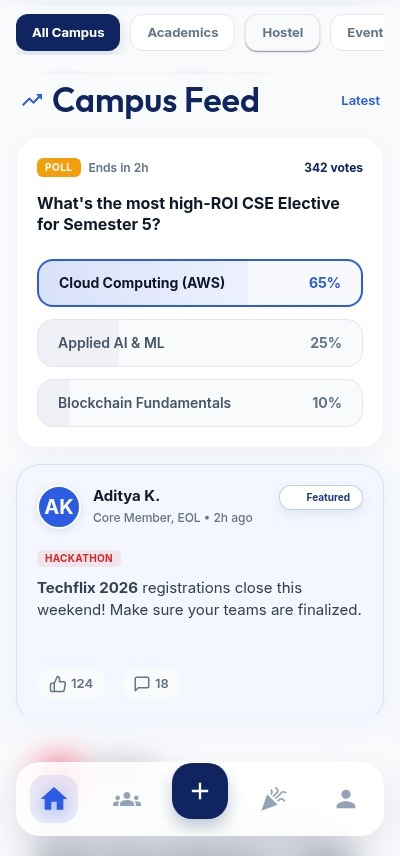
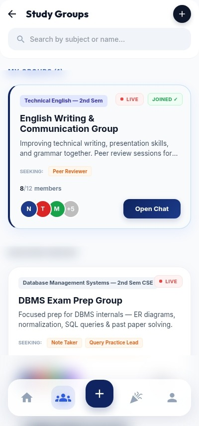
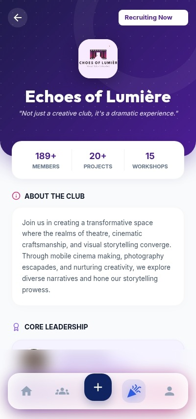
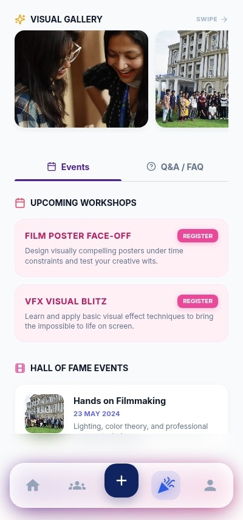
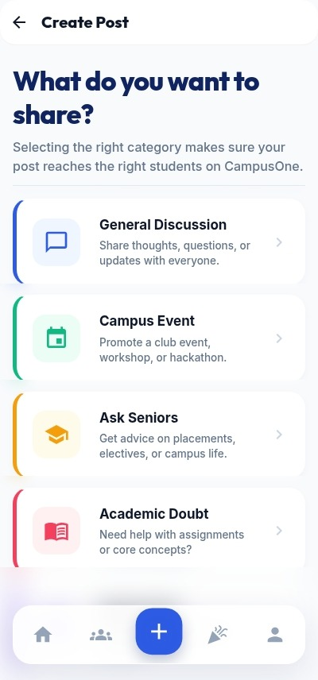

# CampusOne

CampusOne is a mobile-first university ERP and campus communication prototype for DSI. It is designed as an official campus utility, not a social feed, and focuses on fast access to academics, updates, clubs, events, lost & found, study groups, and student services.

## Highlights

- Mobile-first dashboard with quick access to the most important campus actions
- Dedicated sections for academics, updates, clubs, internships, and support flows
- Client-side demo login for presentation and reviewer walkthroughs
- Lightweight routing and reusable UI components built with a consistent institutional look

## Tech Stack

- React 18
- TypeScript
- Vite
- Material UI
- Tailwind CSS utilities
- React Router
- Capacitor for mobile packaging

## Getting Started

Install dependencies:

```bash
npm install
```

Start the development server:

```bash
npm run dev
```

Build for production:

```bash
npm run build
```

## Project Structure

- `src/app/screens` contains the main app screens
- `src/app/components` contains shared layout and reusable UI pieces
- `src/app/routes.tsx` defines navigation and the login guard
- `src/styles` contains global styling and theme layers
- `public` contains static media used by the app
- `android` contains the Capacitor Android wrapper

## Screenshots

<p align="center">
	
	
	
	
	
	
</p>
  